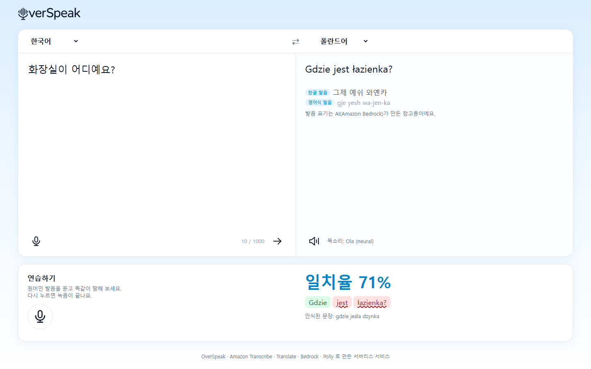
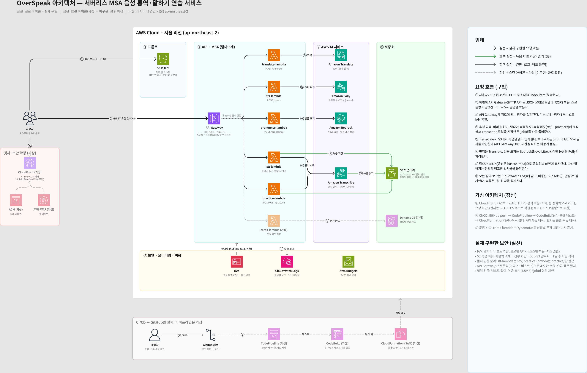

<p align="center">
  
</p>

<p align="center">
  <b>해외에서 현지어로 직접 말하게 도와주는 음성 통역 + 따라 말하기 연습 서비스</b><br>
  AWS 서버리스 · 마이크로서비스(MSA) 아키텍처
</p>

<p align="center">
  <a href="https://local-speak-web-2026.s3.ap-northeast-2.amazonaws.com/index.html"><b>▶ 서비스 바로가기</b></a>
</p>

---

## 소개

번역기는 기계가 **대신** 말해 줄 뿐, 내가 **직접** 말할 수 있게 도와주지는 않습니다.
OverSpeak는 번역 결과를 원어민 발음으로 들려주고, 사용자가 따라 말하면 음성 인식으로 **얼마나 알아들을 수 있게 말했는지(일치율)** 를 보여 줍니다.

- **따라 말하기 연습**: 원어민 발음 듣기 → 따라 말하기 → 일치율(%)과 틀린 단어 표시
- **한글 발음 표기**: 낯선 언어도 바로 읽을 수 있게 한글 + 영어식(로마자) 발음 표기
- **동유럽 언어 지원**: 폴란드어 · 체코어 · 루마니아어 · 헝가리어 등
- **음성 입력**: 내 언어로 말하면 입력칸에 문장이 채워짐

<p align="center">
  
</p>

## 사용 방법

1. 내 언어와 현지 언어를 고릅니다.
2. 🎤 버튼으로 말하거나 직접 입력한 뒤 → 버튼으로 번역합니다.
3. 번역문 아래의 한글·영어식 발음 표기를 확인하고 🔊 버튼으로 원어민 발음을 듣습니다.
4. **연습하기**의 🎤 버튼을 누르고 따라 말한 뒤, 다시 누르면 일치율이 나옵니다.

> 마이크는 HTTPS 페이지에서만 동작하므로 위의 HTTPS 주소로 접속해 주세요.

## 아키텍처

<p align="center">
  
</p>

- **실선** = 실제 구현 / **점선** = 가상 아키텍처 (향후 확장)
- 교재 실습(S3 → API Gateway → Lambda → Translate)을 기반으로 Polly · Transcribe · Bedrock을 추가해 확장했습니다.
- 자세한 요청 흐름과 Mermaid 구성도는 [architecture.md](architecture.md)에 있습니다.

### 요청 흐름

```text
사용자 ─① 화면 로드─→ S3 웹 버킷 (index.html)
   └──② REST 요청──→ API Gateway (HTTP API · CORS · 스로틀링)
                       ├ POST /translate          → translate-lambda → Amazon Translate
                       ├ POST /speak              → tts-lambda       → Amazon Polly
                       ├ POST /pronounce          → pronounce-lambda → Amazon Bedrock (Nova Lite)
                       ├ POST·GET /transcribe     → stt-lambda       → S3 녹음 버킷 → Amazon Transcribe
                       └ POST·GET /practice       → practice-lambda  → S3 녹음 버킷 → Amazon Transcribe
모든 람다 로그 → CloudWatch Logs · 비용 → AWS Budgets
```

음성 인식은 10~30초가 걸려 API Gateway의 30초 제한에 걸릴 수 있으므로 **비동기 방식**으로 처리합니다.
`POST`가 녹음을 S3에 저장하고 Transcribe 작업을 시작한 뒤 바로 `jobId`를 돌려주고, 브라우저가 3초마다 `GET /{jobId}`로 결과를 확인합니다.

### 가상 아키텍처 (점선)

| 기호 | 구성 | 내용 | 현재 방식 |
|---|---|---|---|
| Ⓐ | CloudFront + ACM + WAF | 정식 HTTPS · 캐시 · 웹 방화벽 | S3 HTTPS 주소 직접 접속, API 스로틀링 |
| Ⓑ | CodePipeline → CodeBuild → CloudFormation(SAM) | push 시 테스트 후 자동 배포 | 콘솔 수동 배포 |
| Ⓒ | cards-lambda + DynamoDB | 상황별 문장 카드 저장 · 다시 듣기 | 미구현 |

개발 중 실제로 겪은 한계(HTTP에서 마이크 차단, 429 오류, 수동 배포)에 대한 정식 해결책이지만,
비용(상시 과금)과 서비스 규모를 고려해 가상으로 표기했습니다.

## 엔드포인트

| 구분 | 주소 |
|---|---|
| 웹 서비스 | https://local-speak-web-2026.s3.ap-northeast-2.amazonaws.com/index.html |
| API | https://okkwmmuwl5.execute-api.ap-northeast-2.amazonaws.com |

> 과제 평가 후 모든 AWS 리소스를 삭제할 예정이라, 이후에는 링크가 동작하지 않을 수 있습니다.

## API 경로 · 람다 · IAM 권한

| API 경로 | 람다 | AWS 서비스 | IAM 권한 (람다별 별도 역할) |
|---|---|---|---|
| `POST /translate` | translate-lambda | Amazon Translate, Comprehend | `translate:TranslateText`, `comprehend:DetectDominantLanguage` |
| `POST /speak` | tts-lambda | Amazon Polly | `polly:SynthesizeSpeech`, `polly:DescribeVoices` |
| `POST /pronounce` | pronounce-lambda | Amazon Bedrock (Nova Lite) | `bedrock:InvokeModel` (Nova Lite 추론 프로필·모델로 제한) |
| `POST /transcribe`<br>`GET /transcribe/{jobId}` | stt-lambda | Amazon Transcribe, S3 | `transcribe:Start/GetTranscriptionJob`, 녹음 버킷 `stt/*` 읽기·쓰기 |
| `POST /practice`<br>`GET /practice/{jobId}` | practice-lambda | Amazon Transcribe, S3 | `transcribe:Start/GetTranscriptionJob`, 녹음 버킷 `practice/*` 읽기·쓰기 |
| 공통 | 모든 람다 | CloudWatch Logs | `AWSLambdaBasicExecutionRole` |

## MSA 설계

- **기능 1개 = 람다 1개 = API 경로 1개** — 람다 5개, 경로 7개. 람다끼리 직접 호출하지 않습니다.
- **장애 격리** — 발음 표기(Bedrock)가 실패해도 번역 · 듣기는 그대로 동작합니다.
- **최소 권한** — 람다마다 별도 IAM 역할. 음성 입력과 따라 말하기는 같은 녹음 버킷을 쓰지만 서로의 폴더(`stt/` · `practice/`)에는 접근할 수 없습니다.
- **독립 배포 · 자동 확장** — 기능별로 따로 배포하고, 요청이 늘면 Lambda가 자동으로 동시 실행을 늘립니다.

## 보안 · 비용

- S3 녹음 버킷: 퍼블릭 액세스 전부 차단, SSE-S3 암호화, **1일 후 자동 삭제** (개인 음성 보관 최소화)
- API Gateway 스로틀링: 초당 2건 · 버스트 5 (과도한 호출과 요금 폭주 방지, 프론트는 429 시 자동 재시도)
- 입력 제한: 번역 1000자, 음성 500자, 녹음 15초 · 1.5MB
- 서버를 켜 두지 않는 **요청당 과금** 서비스만 사용 (EC2 · NAT Gateway · RDS 없음)
- Bedrock은 가장 저렴한 **Amazon Nova Lite** 모델 사용, 출력 토큰 제한 (1,000회 호출 약 $0.06)
- AWS Budgets 월 $5 예산 알림

## 지원 언어

| 구분 | 언어 | 번역 | 음성 인식 | 원어민 발음 | 따라 말하기 |
|---|---|:-:|:-:|:-:|:-:|
| 완전 지원 | 한국어, 영어, 일본어, 중국어(간체·번체), 스페인어, 프랑스어, 독일어, 러시아어, 이탈리아어, 아랍어 | ✅ | ✅ | ✅ | ✅ |
| 완전 지원 (동유럽) | 폴란드어, 체코어, 루마니아어 | ✅ | ✅ | ✅ | ✅ |
| 부분 지원 | 베트남어, 태국어, 인도네시아어, 헝가리어 | ✅ | ✅ | ❌ | ❌ |

부분 지원 언어는 Amazon Polly에 해당 언어 목소리가 없어 듣기와 따라 말하기를 제공하지 않습니다.

## 기술 스택

| 영역 | 사용 기술 |
|---|---|
| 프론트엔드 | HTML · CSS · 바닐라 JavaScript (단일 `index.html`, 빌드 도구 없음), MediaRecorder |
| 백엔드 | AWS Lambda (Python 3.12, arm64, boto3만 사용) |
| API | Amazon API Gateway (HTTP API) |
| AI 서비스 | Amazon Translate, Amazon Polly, Amazon Transcribe, Amazon Bedrock (Nova Lite) |
| 저장소 | Amazon S3 (정적 웹 호스팅, 녹음 버킷) |
| 운영 | AWS IAM, Amazon CloudWatch Logs, AWS Budgets |
| 리전 | 아시아 태평양(서울) `ap-northeast-2` |

## 폴더 구조

```text
├─ frontend/
│  ├─ index.html            # 화면 전체 (API_BASE 상수 하나로 API 주소 관리)
│  └─ logo.png
├─ lambdas/                 # 람다 1개 = 파일 1개
│  ├─ translate_lambda.py   # 번역
│  ├─ tts_lambda.py         # 원어민 음성
│  ├─ pronounce_lambda.py   # 발음 표기
│  ├─ stt_lambda.py         # 음성 입력
│  └─ practice_lambda.py    # 따라 말하기 일치율
├─ docs/
│  ├─ 배포가이드_1~4_*.md    # 기능별 콘솔 배포 가이드
│  └─ images/               # 로고, 화면, 아키텍처, 사이트맵, 유저플로우
├─ architecture.md          # 구성도(Mermaid) · 요청 흐름 · 권한 표
└─ PRD.md                   # 요구사항 문서
```

## 배포

AWS 콘솔에서 수동으로 배포했습니다. 기능별 순서는 아래 가이드를 따릅니다.

1. [번역 · 원어민 음성](docs/배포가이드_1_번역_음성.md) — S3 웹 버킷, API Gateway, translate · tts 람다
2. [발음 표기](docs/배포가이드_2_발음표기.md) — Bedrock Nova Lite, pronounce 람다
3. [따라 말하기](docs/배포가이드_3_따라말하기.md) — S3 녹음 버킷, practice 람다
4. [음성 입력](docs/배포가이드_4_음성입력.md) — stt 람다

람다 코드는 외부 라이브러리 없이 파일 하나로 완결되어 있어 콘솔에 그대로 붙여넣어 배포할 수 있습니다.
배포 후 `frontend/index.html`의 `API_BASE`를 자신의 API Gateway 주소로 바꿔 S3에 업로드하면 됩니다.

## 한계

- 일치율은 억양 · 강세 채점이 아니라 **원어민 기준 음성 인식이 알아들을 수 있게 말했는가**를 측정합니다.
- 발음 표기는 AI(Bedrock)가 만든 참고용이라 실제 발음과 다를 수 있습니다.
- 음성 인식은 일괄 처리 방식이라 결과까지 10~30초가 걸립니다.

## 참고

- 기반 실습: 『당신이 지금 알아야 할 AWS』 8.6 마이크로서비스 기반 번역 웹 서비스 — 교재의 Node.js 코드는 현재 Lambda 런타임에서 동작하지 않아 Python 3.12로 다시 작성했습니다.
- [사이트맵](docs/images/sitemap.png) · [화면 유저플로우](docs/images/userflow.png)
