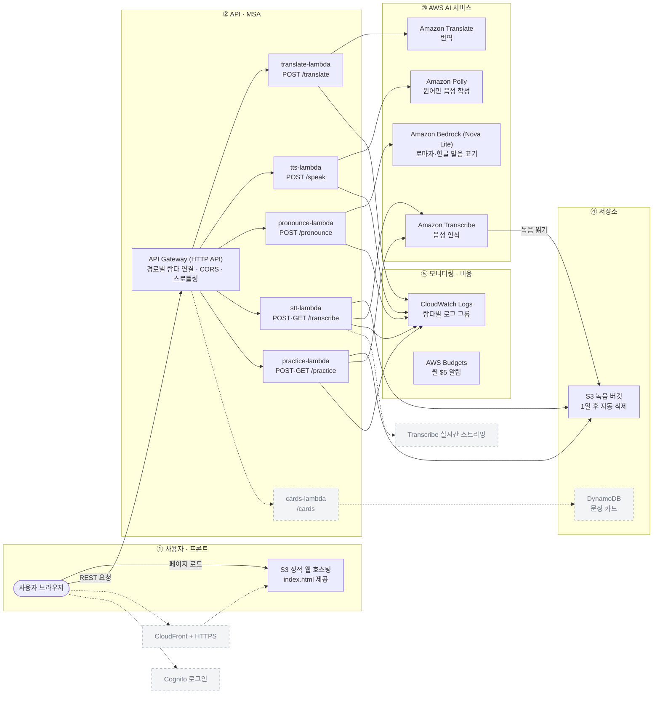

# 아키텍처

> 실제 구현 상태에 맞춰 단계마다 갱신합니다. 보고서 제출용 구성도는 `architecture.drawio`(AWS 공식 아이콘)로 따로 만듭니다.
> 현재 상태(2026-11-16): **1순위 완료.** S3 정적 웹(`http://local-speak-web-2026.s3-website.ap-northeast-2.amazonaws.com`) → API Gateway → 람다 2개 → Translate·Polly 전체 흐름 동작 확인 (한→폴란드어 번역·듣기, 헝가리어 듣기 비활성화).

## 구성도

- **실선** = 구현 대상 (1~4단계) / **점선 + 회색** = 가상 아키텍처 (미구현·향후 확장)

## 요청 흐름

**번역·듣기 (1단계)**
1. 사용자가 S3 웹사이트에서 `index.html`을 받는다.
2. [번역하기] → 브라우저가 API Gateway `POST /translate` 호출
3. API Gateway가 `translate-lambda` 실행 → Amazon Translate `TranslateText`
4. 번역문을 JSON으로 응답 → 화면에 표시
5. [원어민 발음 듣기] → `POST /speak` → `tts-lambda`가 Polly `DescribeVoices`로 목소리 선택 후 `SynthesizeSpeech`
6. mp3를 base64로 응답 → 브라우저가 재생 (같은 문장은 브라우저에 저장된 음성 재사용)
7. 각 람다 실행 로그는 CloudWatch Logs의 람다별 로그 그룹에 따로 쌓인다.

**발음 표기 (2단계)**
1. 번역 결과가 나오면 브라우저가 `POST /pronounce`를 **따로** 호출한다 (번역 결과 표시는 기다리지 않음).
2. `pronounce-lambda`가 Bedrock Converse API로 Amazon Nova Lite를 호출 (모델은 환경 변수 `MODEL_ID`, 출력 토큰 제한).
3. 모델이 돌려준 JSON에서 로마자·한글 발음만 꺼내 응답 → 번역문 아래에 표시.
4. 실패해도 번역·듣기는 그대로 동작한다 (람다·경로가 분리된 **장애 격리**). 같은 문장은 브라우저 캐시로 재호출하지 않는다.

**따라 말하기 (3단계)**
1. 사용자가 원어민 발음을 듣고 [녹음 시작] → 브라우저 MediaRecorder로 최대 15초 녹음 (마이크는 HTTPS 페이지에서만 허용 → S3 HTTPS 주소로 접속)
2. 녹음(base64)과 정답 문장을 `POST /practice`로 전송
3. `practice-lambda`가 녹음과 정답 문장을 S3 녹음 버킷(`practice/`)에 저장하고, Transcribe 일괄 작업을 **현지 언어 코드**(예: `pl-PL`)로 시작 → 바로 `jobId` 응답 (202)
4. Transcribe가 S3에서 녹음을 읽어 인식 (보통 10~30초)
5. 브라우저가 3초마다 `GET /practice/{jobId}` 확인 (API Gateway 30초 제한을 피하는 **비동기 폴링**)
6. 완료되면 람다가 인식 결과와 정답 문장을 비교 (정규화 → 편집 거리 일치율 %, 단어별 맞음/틀림) → 화면에 점수·틀린 단어 표시
7. 녹음 버킷은 수명주기 규칙으로 1일 후 자동 삭제 (개인 음성 보관 최소화 + 저장 비용 0에 가깝게)

## API 경로 → 람다 → AWS 서비스 → IAM 권한

| API 경로 | 람다 | 연결 AWS 서비스 | IAM 권한 (람다별 별도 역할) | 상태 |
|---|---|---|---|---|
| `POST /translate` | translate-lambda | Amazon Translate (+ Comprehend: 자동 감지 시) | `translate:TranslateText`, `comprehend:DetectDominantLanguage` | API 경유 호출 성공 (200) |
| `POST /speak` | tts-lambda | Amazon Polly | `polly:SynthesizeSpeech`, `polly:DescribeVoices` | API 경유 호출 성공 (200, neural 음성 Ola) |
| `POST /pronounce` | pronounce-lambda | Amazon Bedrock | `bedrock:InvokeModel` (Nova Lite 추론 프로필 `apac.amazon.nova-lite-v1:0` + 모델 ARN만) | API 경유 호출 성공 (2026-11-16) |
| `POST /transcribe`, `GET /transcribe/{jobId}` | stt-lambda | Amazon Transcribe, S3 녹음 버킷 | `transcribe:StartTranscriptionJob`, `transcribe:GetTranscriptionJob`, `s3:PutObject`, `s3:GetObject` | 미착수 |
| `POST /practice`, `GET /practice/{jobId}` | practice-lambda | Amazon Transcribe, S3 녹음 버킷 | `transcribe:StartTranscriptionJob`, `transcribe:GetTranscriptionJob`, 녹음 버킷 `practice/*`의 `s3:PutObject`·`s3:GetObject` | 웹 화면 동작 확인 (2026-11-16, 폴란드어 일치율 표시) |
| `/cards` | cards-lambda | DynamoDB | `dynamodb:PutItem`, `dynamodb:Query` | 가상 |
| 공통 | 모든 람다 | CloudWatch Logs | `AWSLambdaBasicExecutionRole` | - |
